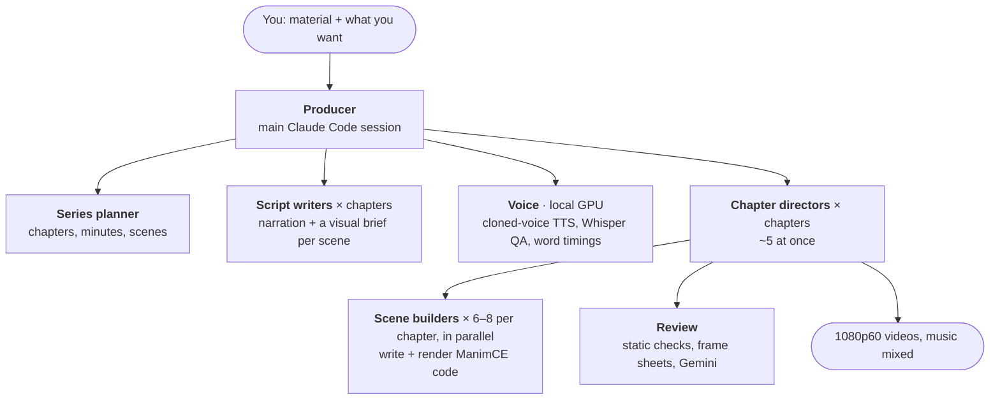

# 3Claude1Cam

**Turns any lecture into narrated, 3Blue1Brown-style animated videos, fully automatically.**

Hand it a lecture's slides, notes or recording, and say what you want: *"Make videos for lecture 5.
I'm comfortable with recursion, so spend longer on the proofs."* A team of around 50 AI agents then
plans, scripts, voices, animates, reviews and renders a series of 8–11 minute explainer videos,
with no human editing. Everything runs from a single Mac.

I built it to study for my own university courses. Each series follows my request: what to focus
on, how deep to go, what I already know.

> **This repository contains no videos, voices, music or lecture material.** The lectures belong
> to their authors, and the narration voice and the soundtrack aren't mine to redistribute. What's
> here is the studio itself: the agents, the engine and the docs. [Bring your own](#bring-your-own)
> describes how those parts plug in.

## How it works



1. **Plan.** A planner agent reads the material and splits the lecture into chapters. Each
   chapter answers one question in 8–11 minutes, ends in a recap, and is broken into 6–8 scenes.
   A lecture recording is first transcribed locally by Whisper. Gemini then watches it and writes
   down what was on the board.
2. **Script.** One writer per chapter, all in parallel, writes the narration for the ear, plus a
   visual brief for every scene. Any code shown on screen is run through the real toolchain before
   it goes in. The planner then reviews all the scripts for continuity.
3. **Voice.** A cloned voice reads the narration locally, one sentence at a time (Chatterbox
   Turbo on the Mac's GPU via MLX). Three Whisper models transcribe every take back. When two of
   them disagree with the script, the sentence is re-recorded, and a sentence that keeps failing
   gets rewritten. This step also produces word-level timings, which drive the animation.
4. **Animate.** A director per chapter writes a music cue sheet, then launches 6–8 scene builders
   at once. Each builder gets a ~1k-token packet: its brief and the timing of every sentence. It
   writes one ManimCE scene whose animations land on the spoken words they illustrate.
5. **Review.** `vk check` audits every scene before a single frame is rendered. It catches
   narration overrunning the animation, text cut off or overlapping, things on screen too briefly
   to read, and messy transitions. The director then reviews a sheet with the last still frame of
   every narration line. Gemini watches the renders and listens to the voice. Its findings are
   treated as claims: each one is confirmed against a real frame first, and recurring glitches are
   fixed at their cause in the engine rather than scene by scene.
6. **Render.** Final 1080p60 renders. Scenes that flow into each other end on exactly the frame
   the next one opens on, and the music is mixed and ducked under the voice.

## Making ~50 agents fit on one laptop

- **Small contexts, nested agents.** An agent's cost is roughly its turns times its context size.
  The first version ran in one session that grew to 854k tokens of context and burned ~450M tokens
  on a single lecture. Now each agent holds only its own concern: the producer sees reports, a
  director sees one chapter, a builder sees one scene. Builders share an identical, cached system
  prompt instead of reading docs. Cost per scene fell from 6–11M tokens to ~3M.
- **A memory-aware scheduler** (`engine/tools/slots.py`). Every heavy job declares its measured
  memory: a voice run 7 GB, a final render 1.2 GB, a preview 0.75 GB. A job starts only when it
  fits in the budget and macOS isn't under memory pressure. GPU and render slots are file locks,
  which free themselves even if the holder crashes. Measured on the machine: five parallel
  directors is the point where it saturates, and production runs 3× faster than with two
  (3.5 vs 1.2 chapters an hour).
- **Local where it's cheap, cloud where it's smart.** Speech synthesis and recognition run locally
  and cost no tokens. Claude does the writing and the animation. Gemini is used only where it adds
  a sense Claude doesn't have, watching video and hearing audio, on a fixed weekly budget.
- **State lives in files, not conversations.** A session can hit a usage limit at any moment.
  `vk status` reads the project's files, and the next session resumes at the first unfinished stage.

Every one of these decisions came from a measured failure. [`docs/LESSONS.md`](docs/LESSONS.md)
records each one with its numbers.

## Using it

Start [Claude Code](https://docs.anthropic.com/en/docs/claude-code) in the folder and say what you need:

- *"Make videos for lecture 5 from `~/Downloads/lecture5.pdf`."*
- *"Here's the recording of today's lecture: make a series, and go slower on the proofs."*
- *"I need a 10-minute video on Dijkstra's algorithm."*
- *"Continue."* · *"Where are we?"* · *"In chapter 4 the trace is too small. Fix it."*

`CLAUDE.md` is the producer's runbook, which Claude reads automatically. Finished videos land in
`projects/<series>/out/`. Every step is also a `vk` command (`engine/vk`), listed in
[`docs/PIPELINE.md`](docs/PIPELINE.md).

The studio can also run on OpenAI Codex (`AGENTS.md`, `.codex/agents/`). I built the same lecture
with both and compared them, blind with Gemini as the judge and then by eye. The Claude build is
the default.

## Setup

macOS on Apple Silicon (for MLX), [uv](https://docs.astral.sh/uv/), Claude Code, and from Homebrew
`ffmpeg` and `poppler`. You also need a TeX install (MacTeX), and the toolchain for any code shown
on screen. Gemini is optional: it runs through the Antigravity CLI (`agy`), and the pipeline runs
without it.

```sh
git clone https://github.com/markitwecode/3Claude1Cam && cd 3Claude1Cam

# the agents use absolute paths: point them at your clone
grep -rl /path/to/3Claude1Cam CLAUDE.md AGENTS.md .claude .codex docs | xargs sed -i '' "s|/path/to/3Claude1Cam|$PWD|g"

cd engine
uv venv -p 3.11 .venv     && uv pip install --python .venv/bin/python -r requirements-manim.lock
uv venv -p 3.12 .venv-mlx && uv pip install --python .venv-mlx/bin/python -r requirements-voice.lock
```

The model weights (Chatterbox Turbo ≈ 2.8 GB, plus three Whisper models) download on first use.

### Bring your own

- **A voice.** You need a 12–15 second clean clip of a voice you have the right to clone (your own
  is simplest). It should start on speech, with no leading silence. Save it as
  `engine/assets/voice/refs/ref_c.wav` (the path is set in `engine/tools/voice.py`). The clone
  copies the speaker's pace, so pick a calm one. `vk audition <clip.wav>` voices a test passage
  with any clip.
- **Music.** Put tracks you're licensed to use in `engine/assets/music/album/`. Directors place
  them by narration line, never by seconds. The engine measures each track's loudness and sets the
  beds 20–25 dB under the voice, with gentle ducking. My private copies use the 3Blue1Brown
  soundtrack by Vincent Rubinetti, which needs
  [the composer's permission](https://vincerubinetti.github.io/using-the-music-of-3blue1brown/)
  to publish.
- **The reference library.** Agents look up Manim usage in `engine/reference/` instead of writing
  it from memory (`engine/reference/INDEX.md`). To recreate it:
  ```sh
  cd engine/reference
  git clone --depth 1 --branch v0.22.0 https://github.com/ManimCommunity/manim manim-v0.22.0
  git clone --depth 1 https://github.com/adithya-s-k/manim_skill
  git clone https://github.com/3b1b/videos 3b1b/videos  && git -C 3b1b/videos checkout 306a134
  git clone https://github.com/3b1b/manim  3b1b/manimgl && git -C 3b1b/manimgl checkout fafa083
  mkdir -p ../../.claude/skills && cp -r manim_skill/skills/manimce-best-practices ../../.claude/skills/
  ```
  My notes distilled from 3Blue1Brown's video code are not included: his pacing, his recurring
  patterns, and ports of his ManimGL helpers to ManimCE (`PATTERNS.md`, `GL_TO_CE.md`,
  `ce_ports.py`). That code is CC BY-NC-SA, so they aren't mine to publish. The helpers that
  ship are reimplemented in `engine/lib/effects.py`.
- **Material.** Your lecture slides, notes or recordings. `vk new` copies them into the project's
  `source/` folder, and `vk lecture <video>` turns a recording into a transcript and a digest.

## Layout

| Path | What |
|---|---|
| `CLAUDE.md` | The producer's runbook: who does what, in what order, under which limits |
| `.claude/agents/` | The four agent types: series-planner, script-writer, chapter-director, scene-builder |
| `engine/vk` | The CLI behind every step |
| `engine/lib/` | The scene library: narration sync, layout kit, motion, 3b1b-style effects, palette |
| `engine/tools/` | Voice and QA, the render pipeline, static checks, the scheduler, Gemini reviews, lecture digests |
| `docs/PIPELINE.md` | Stages, file formats, commands and recovery |
| `docs/LESSONS.md` | Every pitfall paid for so far, with measurements |
| `docs/STYLE.md` | The visual style, calibrated against 3Blue1Brown |
| `projects/` | One folder per video series, created by `vk new` (not tracked here) |

Built with [ManimCE](https://www.manim.community/), [Claude Code](https://docs.anthropic.com/en/docs/claude-code),
[Chatterbox](https://github.com/resemble-ai/chatterbox) via [mlx-audio](https://github.com/Blaizzy/mlx-audio),
[Whisper](https://github.com/openai/whisper) and Gemini.
